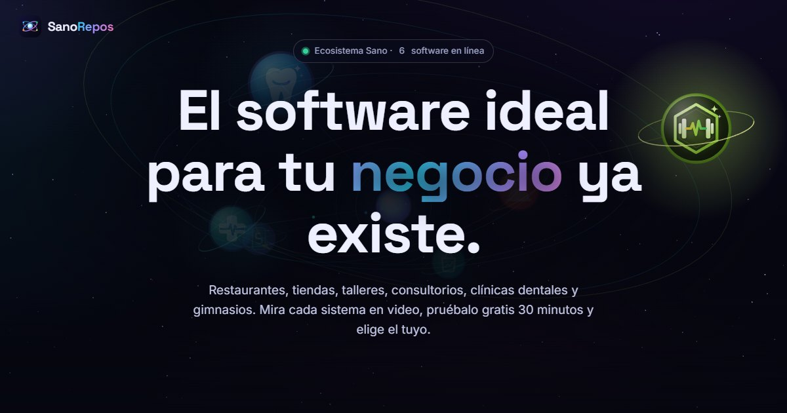
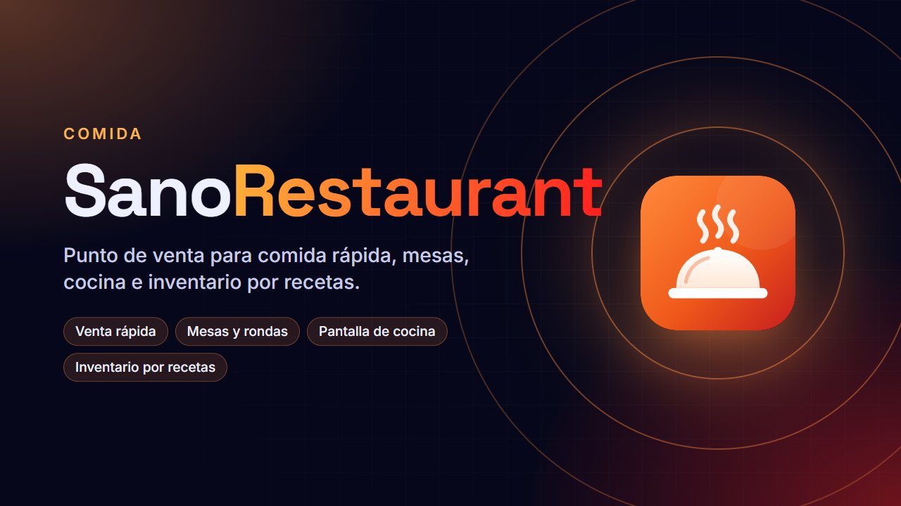
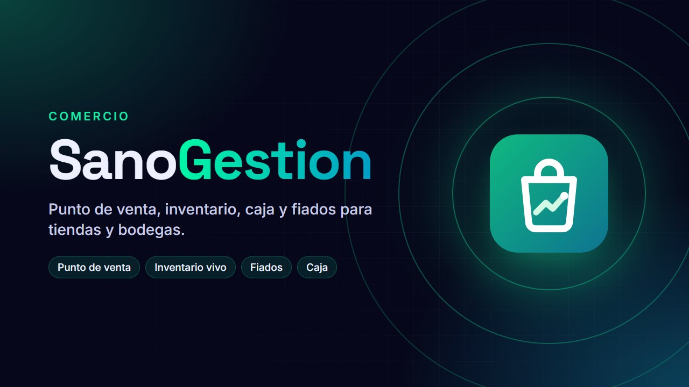
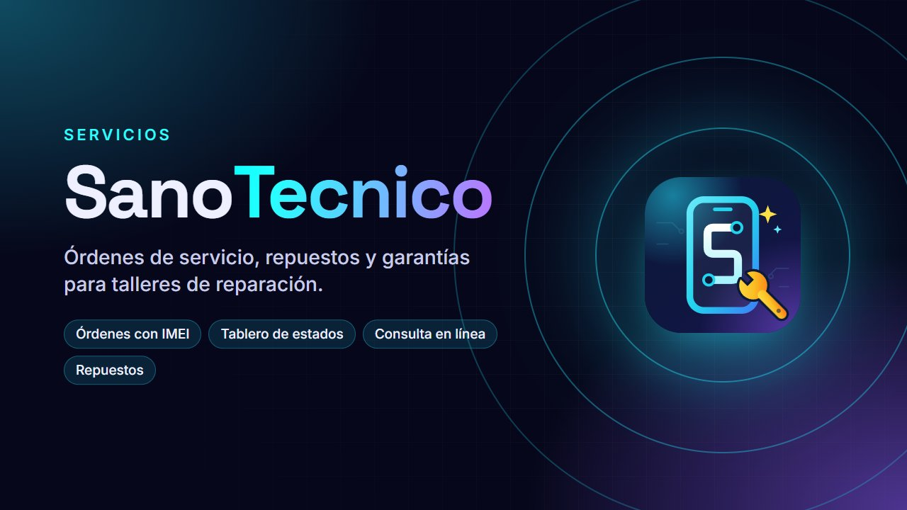
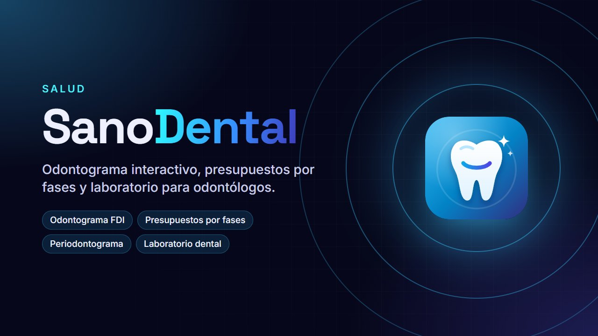
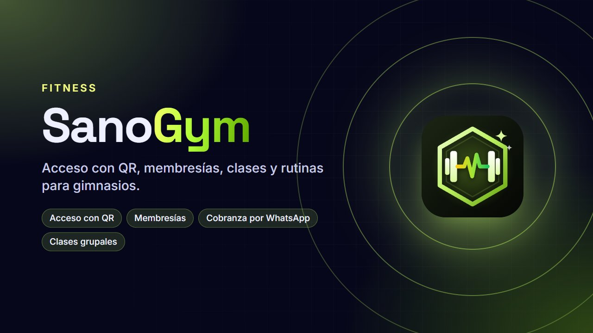

### Software para negocios de Latinoamérica, listo para usar desde el navegador

Restaurantes · Tiendas y bodegas · Talleres · Consultorios · Clínicas dentales · Gimnasios

---

## 👋 Hola

Creo **software de gestión** pensado para el día a día de cada negocio: vender, cobrar, agendar, llevar el inventario y atender mejor a los clientes.

- 📲 **Se instalan como app** en el teléfono, la tablet o la computadora, sin tiendas ni descargas.
- 🧪 **Prueba gratis 30 minutos** con datos de ejemplo, sin registrarte.
- 🌎 **Hechos para Latinoamérica:** moneda y formas de pago de cada país, y avisos por WhatsApp.
- 🔒 **Documentos con QR verificable**, recorridos guiados y un video tutorial en cada sistema.

---

## 🚀 Mis software

<table>
  <tr>
    <td width="50%" valign="top">
      
      <h3>🍔 SanoRestaurant</h3>
      Punto de venta para comida rápida: mesas, cocina e inventario por recetas.  
      <a href="https://sano-restaurant.web.app">🌐 Probar</a> · <a href="https://github.com/coxc4418-hue/SanoRestaurant">📦 Código</a>
    </td>
    <td width="50%" valign="top">
      
      <h3>🛒 SanoGestion</h3>
      Punto de venta, inventario, caja y fiados para tiendas y bodegas.  
      <a href="https://sano-gestion.web.app">🌐 Probar</a> · <a href="https://github.com/coxc4418-hue/SanoGestion">📦 Código</a>
    </td>
  </tr>
  <tr>
    <td width="50%" valign="top">
      
      <h3>🔧 SanoTecnico</h3>
      Órdenes de servicio, repuestos y garantías para talleres de reparación.  
      <a href="https://sano-tecnico.web.app">🌐 Probar</a> · <a href="https://github.com/coxc4418-hue/SanoTecnico">📦 Código</a>
    </td>
    <td width="50%" valign="top">
      
      <h3>🩺 SanoDoctor</h3>
      Agenda, historia clínica, récipes y documentos con QR para consultorios.  
      <a href="https://sano-doctor.web.app">🌐 Probar</a> · <a href="https://github.com/coxc4418-hue/SanoDoctor">📦 Código</a>
    </td>
  </tr>
  <tr>
    <td width="50%" valign="top">
      
      <h3>🦷 SanoDental</h3>
      Odontograma interactivo, presupuestos por fases y laboratorio para odontólogos.  
      <a href="https://sano-dental.web.app">🌐 Probar</a> · <a href="https://github.com/coxc4418-hue/SanoDental">📦 Código</a>
    </td>
    <td width="50%" valign="top">
      
      <h3>💪 SanoGym</h3>
      Acceso con QR, membresías, clases y rutinas para gimnasios.  
      <a href="https://sano-gym.web.app">🌐 Probar</a> · <a href="https://github.com/coxc4418-hue/SanoGym">📦 Código</a>
    </td>
  </tr>
</table>

---

## 🛠️ Con qué los construyo

---

## 🐍 Mi actividad

<picture>
  <source media="(prefers-color-scheme: dark)" srcset="https://raw.githubusercontent.com/coxc4418-hue/coxc4418-hue/output/snake-dark.svg">
  <source media="(prefers-color-scheme: light)" srcset="https://raw.githubusercontent.com/coxc4418-hue/coxc4418-hue/output/snake.svg">
  
</picture>

---

**¿Tienes un negocio y quieres organizarlo?** Escríbeme y te muestro el sistema ideal para ti.

